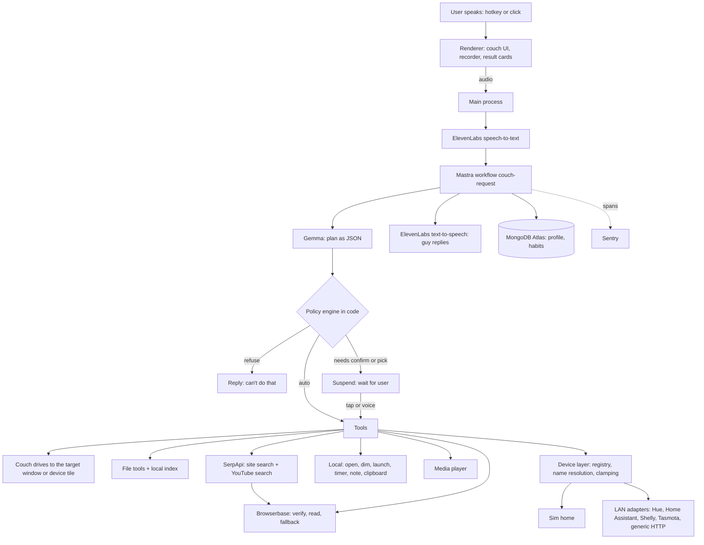

# Couch

A lazy pixel guy sits on a couch in the corner of your screen. You talk to him. He finds your files, finds things on websites you name, plays media, drives your smart devices, and runs small errands on your laptop. The couch drives across the screen to whatever he is doing. He stays seated. He complains, but still does it.

Windows first. macOS is untested.

## Setup

1. Install [Node.js](https://nodejs.org) 22 or newer and [Ollama](https://ollama.com/download).
2. Clone the repo, then:

   ```bash
   npm i
   cp .env.example .env   # fill in the keys you have; every one is optional except the brain
   npm start
   ```

3. First run opens setup: brain check (offers to download the Gemma tag, shows the size, waits for your click), permissions (folders, voice, devices), then five quick questions.

Hotkey: `Ctrl+Alt+Space` (change it in the tray). Press to start listening, press again to stop. Or click the guy and type.

Other scripts: `npm test` (Vitest), `npm run typecheck`, `npm run dist` (Windows installer in `release/`), `npx tsx scripts/eval-plan.ts` (20 requests through your local brain: valid-plan count and time to plan).

### The installer is unsigned

`npm run dist` builds an NSIS installer that is not code-signed. Windows SmartScreen shows "Windows protected your PC / unknown publisher". Click **More info**, then **Run anyway**. For the installed app, put your `.env` in `%APPDATA%\couch\.env`.

## The brain (wording rule)

Gemma is an **open-weight** model (not "open source"). By default it runs **locally through Ollama**, so your files and the model's reasoning about them stay on your machine. An optional cloud mode uses the Gemini API; you switch it on yourself in the tray, and Couch never falls back to it on its own. Couch as a whole is **not** "fully local" or "offline": voice (ElevenLabs), web search (SerpApi), the cloud browser (Browserbase), memory (MongoDB) and error tracing (Sentry) are cloud services. Turn voice off and skip the web tools, and a request makes no network call at all.

The model only proposes a plan in a fixed JSON schema. A policy engine in code decides:

| Tier | Meaning | Examples |
| --- | --- | --- |
| T0 | read-only, runs automatically | file.search, web.find, media.search, device.status |
| T1 | reversible or harmless, runs automatically | file.open, screen.dim, timer.set, device.set (lights, TV, AC) |
| T2 | changes data, one confirm tap every time | file.copy, file.move, web.download, unlock a door, device.add |
| T3 | forbidden, never implemented | shell commands, deleting files, sending messages, payments, passwords |

## Architecture



## What leaves this machine

Also in the app: tray, **What leaves this machine**.

| Data | Goes to | When |
| --- | --- | --- |
| Voice audio | ElevenLabs speech-to-text | Every spoken request, only while "Use voice" is on. Never written to disk. |
| Request text, date, profile summary, last turns | Gemma on local Ollama | Every request in the default local mode. Stays on the machine. |
| File names, folders, dates, snippets, extracted file text | Gemma on local Ollama | When a plan or an answer needs them, in local mode. Stays on the machine. |
| Request text, date, profile summary, last turns | Gemma via Gemini API | Every request, only if you chose cloud mode. |
| File names, folders, dates, snippets of search candidates | Gemma via Gemini API | Cloud mode only, only with "send file names to the AI" on. |
| Relevant parts of one file's text | Gemma via Gemini API | Cloud mode only, with "send file contents" on, after a one-time notice per session. |
| The guy's reply text | ElevenLabs text-to-speech | Every reply while voice is on. Never file contents; file names only if "speak file names" is on (off by default). |
| Search keywords and the named site's domain | SerpApi | Web find and media search. Never file names, paths or contents. |
| Page URLs to open | Browserbase | Web find checks, page reading, YouTube fallback. No local files. |
| Download URL | The website itself (direct HTTPS) | Web download, after you tap Yes. |
| Taste profile, habit counts (tool names only), chosen media titles | MongoDB Atlas | After setup and on use, only if `MONGODB_URI` is set. |
| Error traces: tool and step names, durations, error types | Sentry | Only if `SENTRY_DSN` is set. No user text, paths, URLs or device names. |
| Device commands | Devices on your home network only | When you ask. Hosts must be private (LAN) addresses. Cloud-only devices are not supported. |

Never stored in the cloud: file paths, file names, file contents, request text, web addresses, device names, API keys. Logs never contain keys, paths or speech.

## Add a real device tomorrow

1. **Find it or name it.** Turn on "Look for real devices on my network" (setup or tray), then say "look for devices" and "add the second one as kitchen lamp". A confirm sheet shows the exact LAN address. A Hue bridge asks you to press its button first. Or add an entry to `%APPDATA%\couch\devices.json` by hand.
2. **Set the adapter.** Swapping a sim device for a real one is one field: change `"adapter": "sim"` to `"hue"`, `"homeassistant"`, `"shelly"`, `"tasmota"` or `"generic-http"`, and fill `config`. Example, the sim lamp on a generic HTTP plug:

   ```json
   {
     "id": "lamp", "name": "lamp", "aliases": ["floor lamp"], "room": "living room", "kind": "light",
     "adapter": "generic-http",
     "config": {
       "host": "192.168.1.40",
       "commands": {
         "power": { "method": "GET", "path": "/relay?on={value}" },
         "brightness": { "method": "POST", "path": "/dim", "body": { "level": "{value}" } }
       },
       "state": { "path": "/status", "fields": { "power": "on", "brightness": "level" } }
     },
     "capabilities": ["power", "brightness"]
   }
   ```

   Home Assistant entries need `"host"`, `"entity"` (like `light.kitchen`) and `"token"` (a long-lived access token; it stays in this local file).
3. **Say a command.** "Turn on the lamp." The couch drives to the lamp's tile, he presses the button, the state is read back, and he tells you if it did not take.

## The `.tech` domain

1. Claim the domain credit at hacktoberfest.com/my (verify the current steps there).
2. In Render, open the `couch-site` static site (from `render.yaml`), Settings, Custom Domains, add your domain.
3. At the registrar, point DNS where Render says: a CNAME for `www` to the `onrender.com` host, and for the apex either ALIAS/ANAME or the A record Render shows (verify in Render's custom-domain docs). Render issues the TLS certificate once DNS resolves.
4. Set `COUCH_SITE_URL` in `.env` so About links to it, and replace `OWNER/REPO` in `site/index.html`.

## License

MIT. See [LICENSE](LICENSE).
