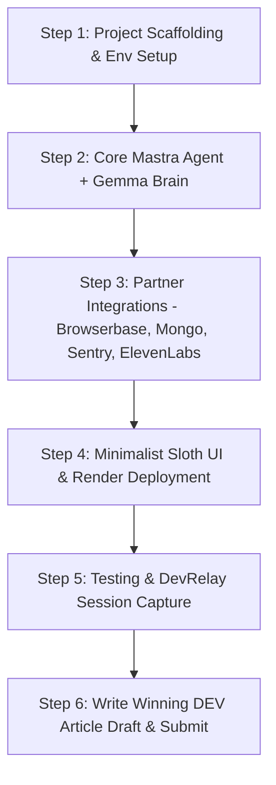

# Hacktoberfest 2026 Week 3: Slow and Steady — Strategy & Requirements (req.md)

## 1. Challenge Snapshot

- **Event:** [Hacktoberfest Open-Source AI Challenge: Week 3 (Slow and Steady)](https://dev.to/devteam/join-the-hacktoberfest-open-source-ai-challenge-slow-and-steady-2850-in-prizes-across-21-3iee)
- **Deadline:** **October 25, 2026, at 23:59 UTC**
- **Platform:** DEV Community (`dev.to`)
- **Theme:** "Slow and Steady" (International Sloth Day theme): Build something with open-weight models or open-source AI that rewards laziness — does the work so you don't have to.
- **Prizes:** $2,850 total prize pool across 21 winners:
  - 1 Overall Winner: $250 + DEV++ + exclusive badge
  - 6 Featured Category Winners: $200 + badge each
  - 14 Partner Category Winners: $100 + badge each
- **Rule on multiple entries:** A single project can enter every category it genuinely uses. You can only win one prize per challenge, but entering multiple categories drastically maximizes winning probability since partner categories have significantly smaller competitor pools.

---

## 2. Multi-Category Targeting Strategy (Maximizing Odds)

To hit the goal of qualifying for **at least 5 prize categories**, we target **7 cohesive categories** (2 Featured + 5 Partner). None are shoehorned; all fit naturally into one automated "sloth-mode" workflow:

| Category | Tier | Role in Architecture |
| :--- | :--- | :--- |
| **1. Best Use of Gemma** | **Featured ($200)** | **Core Brain:** Google's open-weight Gemma model (Gemma 2 / Gemma 3) running inference to reason, synthesize, and extract tasks. |
| **2. Best Use of Mastra** | **Partner ($100)** | **Agent Harness:** Open-source TypeScript agent framework providing agentic workflows, deterministic state machines, tool orchestration, and memory. |
| **3. Best Use of Browserbase** | **Partner ($100)** | **Lazy Hands (Automation):** Cloud headless browser allowing the agent to autonomously fetch, summarize, and navigate web links/dashboards while the user does zero clicking. |
| **4. Best Use of Sentry Agent Tracing** | **Partner ($100)** | **Agent Observability:** Tracing agent reasoning loops, tool latency, token consumption, and failure modes across workflows. |
| **5. Best Use of MongoDB Atlas** | **Partner ($100)** | **Memory & Storage:** Vector search and document storage for digests, user preferences, and scheduled sloth jobs. |
| **6. Best Use of ElevenLabs** | **Partner ($100)** | **Zero-Reading Audio Brief:** Generates a relaxed audio narration of the daily summary so the user doesn't even need to look at the screen. |
| **7. Best Use of Render** | **Featured ($200)** | **Live Deployment:** Deploying the web agent UI and backend with full public availability. |
*(Bonus: `.tech` domain if domain name claimed through GitHub Student Pack / Hacktoberfest perks).*

---

## 3. Project Concept: "SlothBrain" (The Zero-Effort Life Automator)

### What It Does:
An automated background companion for people who hate micro-tasks. You drop in URLs, RSS feeds, or chore queues, and go to sleep. **SlothBrain**:
1. Uses **Browserbase** to visit pages, read updates, scrape newsletter/article contents, and bypass manual browsing.
2. Uses **Mastra** workflows to coordinate tools and persist intermediate execution steps.
3. Uses open-weight **Gemma** to condense hours of reading into a 3-bullet action list ("what matters, what to ignore, what's done").
4. Stores historical summaries and searchable knowledge in **MongoDB Atlas**.
5. Monitors agent health and token usage in real-time with **Sentry Agent Tracing**.
6. Converts the final digest into a soothing 60-second audio morning brief using **ElevenLabs**.
7. Lives completely deployed on **Render** with a clean, dark-mode dashboard.

### Why Open Innovation Matters (Crucial for Write-Up):
- **Zero Lock-In & Total Privacy:** Personal chores, reading queues, and credentials aren't trapped in closed proprietary ecosystems.
- **Local / Self-Hosted Compatibility:** Gemma + Mastra can run fully offline/locally with zero ongoing subscription costs.

---

## 4. What We MUST DO

### A. Repository & Code Requirements
- [ ] Create a brand-new public GitHub repository with an **MIT or Apache 2.0 License** (`LICENSE` file is mandatory).
- [ ] Implement genuine code integrations for all 7 target partner technologies (real imports, valid API/SDK usage, error handling).
- [ ] Include clear setup instructions, environment variable template (`.env.example`), and test coverage.
- [ ] Include a native Mermaid architecture diagram in the README.

### B. Live Demo & Assets
- [ ] Deploy backend + frontend live on **Render** with an accessible public URL.
- [ ] Record a crisp 1–2 minute video or high-quality animated walkthrough demonstrating end-to-end sloth automation (from input to audio digest).
- [ ] Record and capture an AI agent build session via **DevRelay** to embed into the post using ``.

### C. DEV Post Submission Article
Must be posted on DEV before the deadline using the official template:
- [ ] Tags: `devchallenge`, `hf26challenge`, `hacktoberfest`, `productivity`
- [ ] Required Sections:
  1. **What I Built**: Clear summary of what effort it eliminates and who gets to be lazy.
  2. **Demo**: Working public Render link + embedded video/GIF.
  3. **Code**: Embedded public GitHub repo link.
  4. **How I Built It**: Deep dive into the open-source AI architecture (Gemma + Mastra agent loop).
  5. **Why Does Open Innovation Matter?**: Persuasive rationale explaining why open weights/frameworks are strictly better than a closed API wrapper.
  6. **My Agent Session**: Embedded DevRelay session link/tag.
  7. **The Lazy Payoff**: Measurable time saved (e.g. "saves 45 minutes of daily screen time").
  8. **Prize Categories**: Explicitly declare all 7 entered categories with a paragraph for each explaining exact usage.

---

## 5. What NOT to Do (Disqualification & Scoring Killers)

- ❌ **DO NOT use closed-source APIs as the primary brain:** Relying purely on OpenAI GPT-4o or Anthropic Claude violates the core challenge prompt. Open-weight models (Gemma) must be the core.
- ❌ **DO NOT submit fake or superficial partner integrations:** Adding a package import to `package.json` without genuine functional runtime execution gets flagged during partner review.
- ❌ **DO NOT miss the write-up:** DEV judges weigh the article write-up higher than the raw codebase. A complex repo with a lazy post loses to a clean repo with an exceptional post.
- ❌ **DO NOT skip the open-source license:** DEV rules require open-source licensing. Omitting `LICENSE` disqualifies code evaluation.
- ❌ **DO NOT leave broken deployment links:** An inaccessible URL or crashed Render free tier container immediately costs Technical Execution points.
- ❌ **DO NOT miss the strict deadline:** Submissions close strictly on **October 25, 2026, 23:59 UTC**.
- ❌ **DO NOT hide team members:** If collaborating, credit usernames directly in the submission body.

---

## 6. Execution Roadmap

1. **Phase 1: Backend Foundation & Agent Engine**
   - Node.js / TypeScript project with Mastra harness.
   - Gemma model inference connector.
   - Sentry instrumentation (`@sentry/node` + agent tracing).
2. **Phase 2: Lazy Automation Pipelines**
   - Browserbase integration tool to fetch and extract unread web content.
   - MongoDB Atlas client for digest persistence and user queues.
   - ElevenLabs text-to-speech synthesis pipeline.
3. **Phase 3: Clean Dashboard & Deployment**
   - Lightweight frontend (single dashboard to trigger sloth runs, view transcripts, listen to audio).
   - Render blueprint (`render.yaml`) deployment.
4. **Phase 4: DevRelay Session & Submission Draft**
   - Preserve and stage the coding session via DevRelay.
   - Draft DEV article adhering strictly to the Week 3 template.
   - Publish before Oct 25 deadline.
